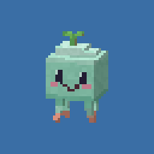
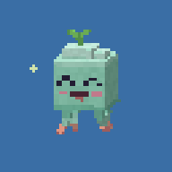
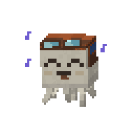
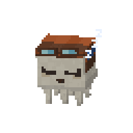
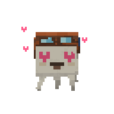
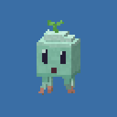
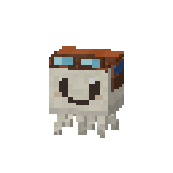
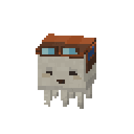
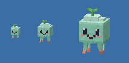

# Puffling

**A tiny, expressive desktop companion for Windows 10 and 11.**

Puffling is a mint-colored, blocky little creature with a leaf sprout and dangling tentacles. It floats around your desktop, reacts to your cursor, and takes the occasional nap. Its default window is just 48 × 48 pixels, so it feels more like a living desktop icon than a full-size app.

<p align="center">
  
  
  
  
</p>

<p align="center"><em>Previews are enlarged so the pixel details are easier to see.</em></p>

## Meet Puffling

- **Give it attention.** Hover to catch its eye, click for a happy bounce, double-click for a dance, or stroke back and forth to pet it.
- **Pick it up.** Drag Puffling around your screen and release it with a flick for a gentle toss.
- **Let it roam.** It wanders, visits other monitors, gets curious about the cursor, and grows sleepy when you are away.
- **Make it yours.** Adjust its size, speed, animation, activity, frame rate, and desktop behavior from the tray icon.
- **Keep your workspace usable.** Transparent pixels let clicks through, interacting with Puffling does not take keyboard focus, and it can hide during fullscreen apps.

<p align="center">
  
  
  
  
</p>

## Run it

You need **Windows 10 or 11** and the [.NET 8 SDK](https://dotnet.microsoft.com/download/dotnet/8.0) to run from source.

```powershell
dotnet run --project src/Puffling.App -c Release
```

Puffling appears near the lower-right corner of your primary monitor. **Left-click the tray icon** for Settings, **right-click it** for actions, or **right-click Puffling** itself. The menu lets you call it over, make it dance, put it to sleep, freeze its position, and more. Settings are saved in `%APPDATA%\Puffling\settings.json`.

To build an executable, run:

```powershell
./build.ps1                 # small exe; requires the .NET 8 runtime
./build.ps1 -SelfContained  # larger exe; includes the runtime
```

The result is `dist/win-x64/Puffling.exe`. The script runs the tests before publishing. For Windows on ARM, add `-Runtime win-arm64`.

## Gestures at a glance

| Do this | Puffling does this |
| --- | --- |
| Hover nearby | Looks toward your cursor |
| Click | Bounces happily; three quick clicks make it excited |
| Double-click | Dances |
| Drag and release | Follows your hand, then settles or gently flies off |
| Stroke back and forth without clicking | Shows hearts |
| Click while it is asleep | Wakes up |

## Actual size

Puffling can be set from **32 to 96 logical pixels** and scales with each monitor's DPI. This image shows the 32, 48, and 96 px renders at their actual pixel sizes:



## How it works

Puffling is written in **C# and .NET 8**. `Puffling.Core` handles the character, animation, behavior, input gestures, movement, and a small CPU voxel renderer. `Puffling.App` displays the frames in a per-pixel-transparent Win32 window and provides the tray menu and settings. The core has no Windows dependency, so its tests and preview generator can run on other operating systems.

```powershell
dotnet run --project tests/Puffling.Tests -c Release
dotnet run --project tools/Puffling.Preview -- preview expressions
```

The test suite covers rendering bounds, gestures, movement, settings, and a simulated multi-monitor session. The Windows overlay itself still needs hands-on testing on Windows, especially for tray, fullscreen, and mixed-DPI behavior.

The character, textures, faces, and animations are original and generated in code; no game assets are included.
