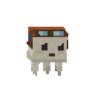
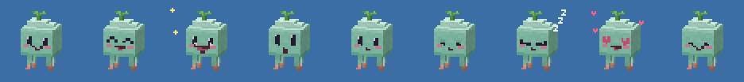

<div align="center">


# Puffling 🌱

### A little bit of life for your desktop.

Puffling is a tiny mint-green voxel creature with a leaf on its head, a few wiggly tentacles, and a lot of feelings. It floats around your Windows desktop, notices you, gets playful, and eventually falls asleep.

**Windows 10/11 · C# · .NET 8 · 48 px of personality by default**

</div>

---

## A day with Puffling

It starts with a quiet float. Move your cursor close and it gets curious. Give it a click and it lights up; give it two and suddenly there's a dance. If you leave it alone for a while, it gets drowsy and drifts off to sleep.

| A little attention | A lot of excitement | Time for a nap |
| :---: | :---: | :---: |
|  |  |  |
| **Hover nearby** | **Double-click** | **Let it rest** |

Puffling has more to do than float in one spot. It can wander, travel between monitors, follow your cursor, or come when you call it from the tray menu. Pet it with a few back-and-forth strokes for hearts. Pick it up and let go with a flick to watch it wobble back into place.

| Pet me | Pick me up | Off I go |
| :---: | :---: | :---: |
|  |  |  |

## Invite Puffling onto your desktop

Install the [.NET 8 SDK](https://dotnet.microsoft.com/download/dotnet/8.0), then run this on **Windows 10 or 11** from the repository folder:

```powershell
dotnet run --project src/Puffling.App -c Release
```

Puffling appears near the lower-right corner of your primary monitor. **Left-click its tray icon** to open Settings. **Right-click the tray icon or Puffling** for actions like *Dance!*, *Come here*, *Go to sleep*, and *Freeze position*.

Want an executable? The build script runs the tests and publishes to `dist/win-x64/Puffling.exe`:

```powershell
./build.ps1                 # requires the .NET 8 runtime on the target PC
./build.ps1 -SelfContained  # bundles the runtime into a larger executable
```

Use `-Runtime win-arm64` when building for Windows on ARM.

## How to say hello

| You | Puffling |
| --- | --- |
| Hover nearby | Looks toward the cursor |
| Click | Gives you a happy bounce; three quick clicks make it excited |
| Double-click | Dances |
| Stroke back and forth without clicking | Shows hearts |
| Drag and release | Dangles, follows, and settles after a gentle toss |
| Click while it sleeps | Wakes up |

Settings let you choose its size, movement speed, animation intensity, activity level, and frame rate. You can also switch wandering and following on or off, keep it on top, start it with Windows, or let it hide during fullscreen apps. Preferences live in `%APPDATA%\Puffling\settings.json`.

## Small on purpose

Puffling's window defaults to **48 × 48 logical pixels** and can be set from **32 to 96**. It scales with your monitor's DPI, stays within the usable screen area, and keeps its animations inside that little square. Transparent pixels pass clicks through, and clicking Puffling leaves keyboard focus in your current app.

<p align="center">
  <br>
  <em>Actual pixel sizes: 32, 48, and 96. The animated previews above are enlarged.</em>
</p>

## What makes it move?

`Puffling.Core` contains the voxel character, software renderer, animations, behavior, movement, gesture detection, and settings. `Puffling.App` puts those pixels into a transparent Win32 overlay and adds the tray menu. The core has no Windows dependency, so its tests and preview generator can run on other systems.

```powershell
dotnet run --project tests/Puffling.Tests -c Release
dotnet run --project tools/Puffling.Preview -- preview expressions
```

The automated tests cover gestures, rendering bounds, movement, settings, and a simulated multi-monitor session. The Windows shell still needs hands-on testing for tray, fullscreen, and mixed-DPI behavior.

<p align="center">
  <br>
  <em>One tiny face, a surprising number of moods.</em>
</p>

The character, textures, faces, and animations are original and generated in code. No game assets are included.
